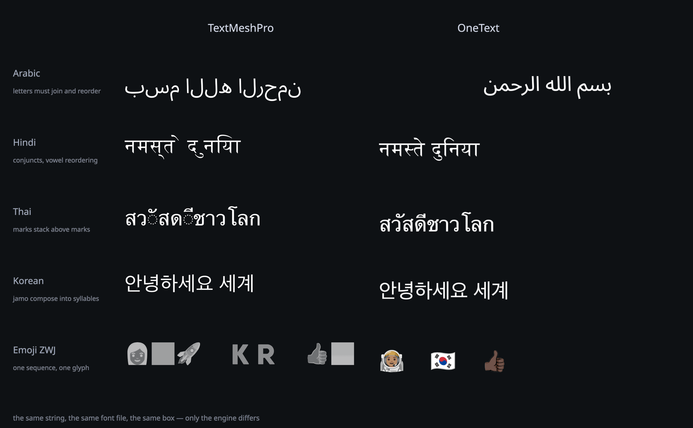
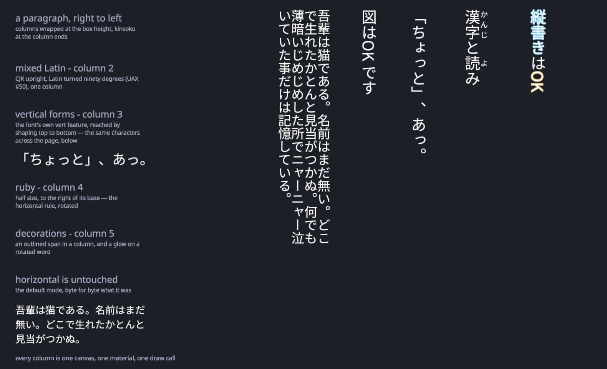
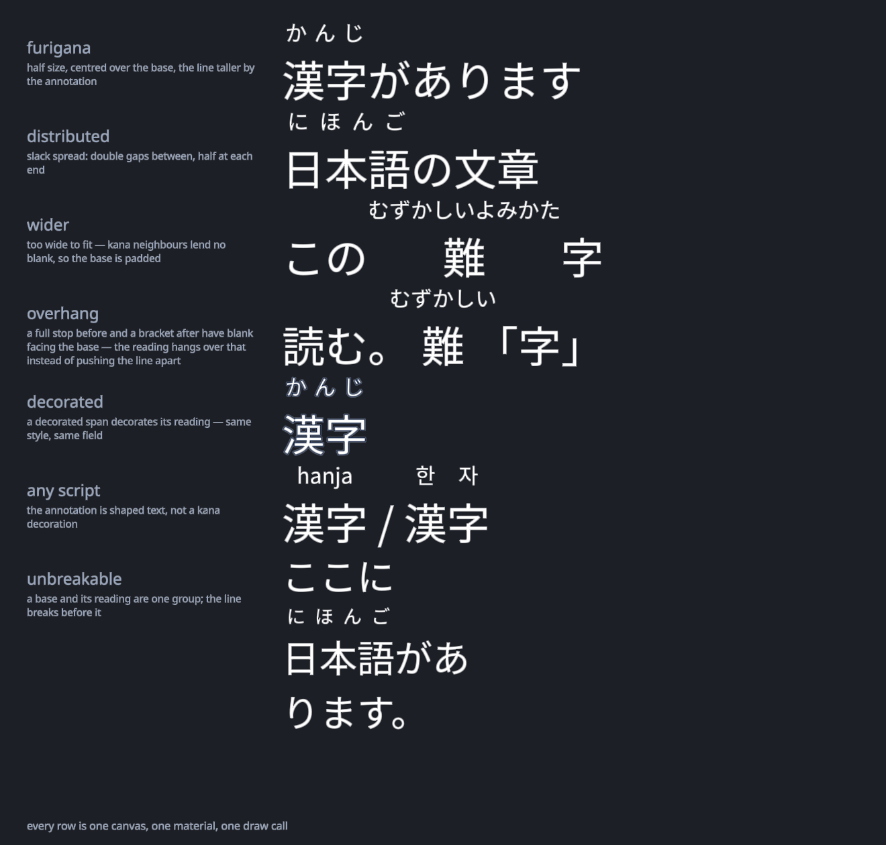
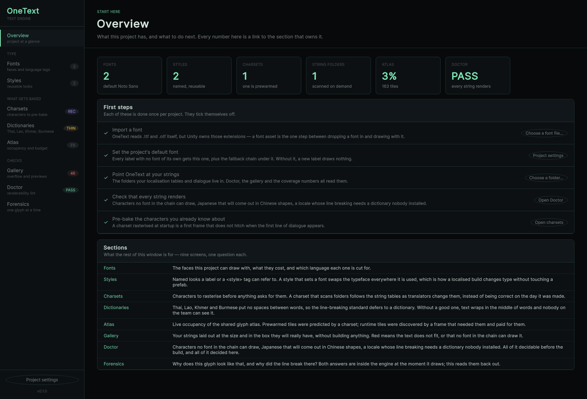
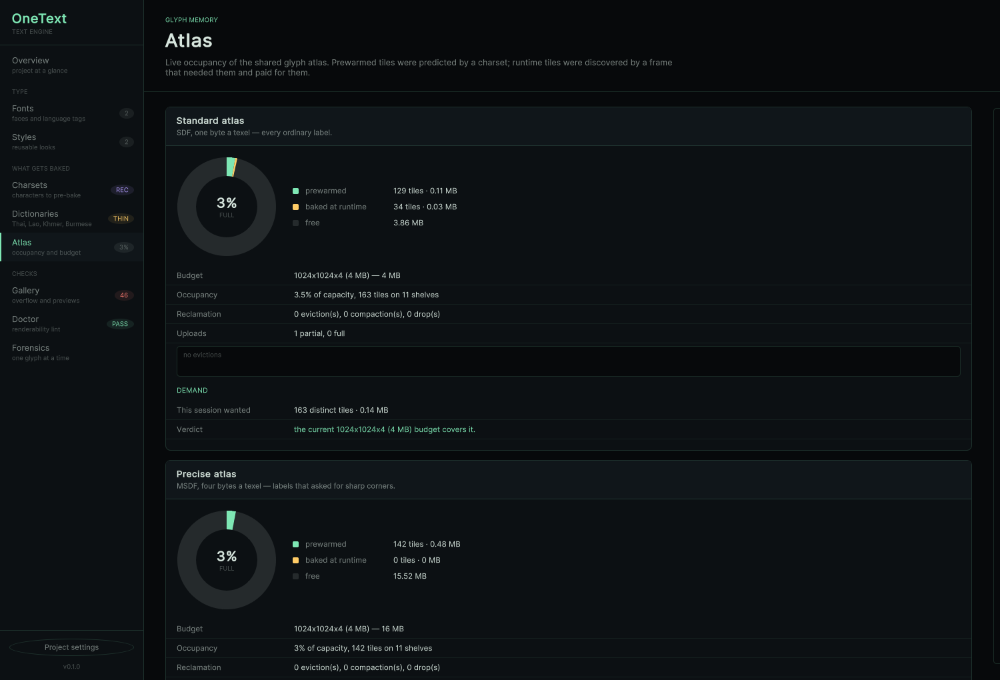

# OneText

**Every language. One draw call.**

[](https://github.com/CodeOneLabs/OneText/releases/latest)
[](https://openupm.com/packages/com.onetext.core/)
[](#requirements)
[](LICENSE)

Thai stacks. Arabic joins. Emoji stay whole. OneText is a free, MIT-licensed
text engine for Unity uGUI, built on the shaping stack the rest of the world
already trusts: HarfBuzz + FreeType, same as Chrome, Android and InDesign.

**[Website](https://memegames.dev/OneText/)** ·
**[Browser demo](https://memegames.dev/OneText/demo/)** ·
[Migrating from TMP](Docs/MIGRATING-FROM-TMP.md) ·
[Benchmarks](Docs/BENCHMARKS.md) ·
[Changelog](CHANGELOG.md) ·
[Roadmap](Docs/ROADMAP.md)



*Same string. Same font. Same box. Only the engine differs.*

## Install

Two steps. No baking. The HarfBuzz/FreeType natives ship inside the package.

**From OpenUPM**

```
openupm add com.onetext.core
```

**From a git URL** — *Window > Package Manager > + > Add package from git URL…*

```
https://github.com/CodeOneLabs/OneText.git
```

Add `#v0.5.0` to the end to stay on one release.

## First label

1. **GameObject > UI > OneText > Label**.
2. Assign a font.
3. Type in any language on Earth.

From code it is the property you would expect, and `.text` still compiles:

```csharp
using OneText.UGUI;

label.Text = "مرحبا · สวัสดี · 안녕하세요";
label.SetText(score);   // int, float and span overloads allocate nothing
```

| You want | Use |
|---|---|
| Text on a canvas | `OneTextLabel` — *GameObject > UI > OneText > Label* |
| An editable field | `OneTextInputField` — *GameObject > UI > OneText > Input Field* |
| A dropdown | `OneTextDropdown` — *GameObject > UI > OneText > Dropdown* |
| Text in the world: nameplates, signs, diegetic UI | `OneTextMesh` — the same pipeline through a MeshRenderer, no Canvas and no uGUI dependency at all |
| Thai, Lao, Khmer or Burmese that wraps on real word boundaries | the **Word-break dictionaries** sample, from the package's page in the Package Manager |

## In the box

One package. Every feature. Nothing sold separately.

| | |
|---|---|
| **Shaping & bidi** | HarfBuzz GSUB/GPOS and full UAX #9. Arabic, Devanagari, Thai, Khmer, Myanmar, Tibetan: contextual forms, reordering, mark stacking. |
| **Rich text & emoji** | Named styles, inline sprites, colour emoji including ZWJ sequences, flags and skin tones, from bitmap, layered (COLRv0) and paint-graph (COLRv1) fonts alike. |
| **Text animation** | Typewriter by grapheme, cluster or syllable, per-punctuation pauses, `<wait=>`, skip, per-unit callbacks, an effects API. |
| **Asian typography** | Kinsoku, punctuation compression, CJK–Latin spacing, Korean word wrap, dictionary line breaking for Thai, Lao, Khmer and Burmese, and a josa tag. |
| **Outline, shadow, glow** | Packed into vertex channels already paid for, so a decorated label and a plain one share one material and one draw call. |
| **Vertical writing & ruby** | 縦書き down right-to-left columns, furigana sized and placed by the layout engine. |
| **An input field that survives an IME** | Korean, Japanese and Chinese composition drawn inline at the caret; no syllable lost on focus change. |
| **System-font fallback** | A character no bundled font covers is drawn from one the device has, not as a box. |
| **World-space text** | `OneTextMesh`, on TMP's world scale so a nameplate keeps its numbers. Labels can size themselves to their rect, too. |
| **Fonts by language** | Fallbacks named by key, and `FontResidency` to load them for the languages in play and unload them when nothing wants them. From Resources, or from Addressables in a project that has it. |
| **The Hub** | *Project Settings > OneText*: the project's defaults (default font and fallback chain, the size and behaviour a new label is created with, the atlas budget), plus fonts, charsets, dictionaries, a string gallery, and Doctor: a renderability lint that exits 1 so CI can fail the merge. Plus Onboarding, which does the mechanical half of leaving TMP. |

## Correctness as a number

Unicode publishes a test for every algorithm it defines. OneText runs all of
them, on every commit:

| Suite | What it covers |
|---|---|
| UAX #9 | bidirectional text |
| UAX #14 | line breaking |
| UAX #29 | grapheme, word and sentence segmentation |
| UTS #51 | emoji |

**888,289 cases, zero failures.** Then once more against real fonts: every
assigned codepoint in Unicode 17.0.0, all 159,631 of them, shaped, outlined,
rasterized and placed.

## Fast where it hurts

A language pack lands mid-session. TextMeshPro stops for **349.9 ms**. OneText
takes **1.6 ms**.

The ordinary frame, too. Medians in µs for a text change plus
`Canvas.ForceUpdateCanvases()`, on an Apple M4 Pro:

| Scenario | OneText | TextMeshPro dynamic |
|---|---|---|
| Live-service HUD | 135 | 283 |
| Chat stream of unseen glyphs | 107 | 683 |
| 200 world-space labels, 50 retexted | 180 | 380 |

Tails, draw calls, a phone — and the runs we lose — are in
[Docs/BENCHMARKS.md](Docs/BENCHMARKS.md), because a comparison that lists only
its wins is an advertisement.

## A look

| | |
|---|---|
|  |  |
| *Vertical writing: kinsoku holding the column ends, ruby beside the column* | *Ruby placed by the W3C rules: distribution, overhang, decorated readings* |
|  |  |
| *The Hub, on the project settings page: defaults, fonts, charsets, dictionaries, atlas and Doctor* | *The atlas, live: per-tile LRU, defragmentation, a budget you set* |

More on the [website](https://memegames.dev/OneText/): MSDF `precise`,
decorations, Doctor and the word-break dictionaries, screen by screen.

## Migrating from TMP

**What already works.** A label is a `MaskableGraphic`, so everything you
know carries over: `RectTransform`, layout groups, `ContentSizeFitter`, masks,
raycasting. There is no atlas to bake first.

**What still compiles.** The lowercase TMP names are kept as aliases, so a
project's four hundred call sites do not have to change on day one:

- `.text`, `.fontSize` and the rest of the lowercase members.
- `lineSpacing`, which converts TMP's offset into OneText's multiplier on the
  way through.
- `alignment`, which takes a `TextAlignmentOptions` this package declares under
  TMP's own names and values, so even the enum-typed lines compile.

**What the Hub's Onboarding tab does.**

1. **Scans** your scenes, prefabs and scripts and counts every TMP and legacy
   text component.
2. **Reports** what will not survive — a margin with no counterpart, a tag
   OneText would print literally, a password field that would lose its
   masking — before it changes anything.
3. **Converts**: swaps the components, re-points every reference and carries
   the listeners.
4. **Rewrites** the mechanical type renames in your own source.

Boring, on purpose.

You do not have to do it all in one afternoon. Tick the scenes and prefabs you
want and convert those; the fields elsewhere in the project that named a
component inside them are found and re-pointed anyway, so the part you did not
convert keeps working. Scan again whenever you want to see what is left.

The whole of it, finding by finding and member by member, is in
[Docs/MIGRATING-FROM-TMP.md](Docs/MIGRATING-FROM-TMP.md).

## Status

**v0.5.0**, 2026-11-25. Everything above is shipped. New in this release:

- **COLRv1 colour glyphs.** The paint-graph format the newer emoji and icon
  fonts are built in — gradients, transforms, compositing — is drawn into the
  same atlas as every other colour glyph. Colour variations are not applied
  yet.
- **A label rebuild costs about half what it did**, and a frame of glyphs
  nobody predicted between a quarter and a twelfth. On a phone (Galaxy Z
  Flip7, IL2CPP) the package is 1.9 to 5.4x faster than 0.4.2.
- **Reading a label's preferred size no longer lays it out every time**, so
  one row animating in a list does not re-shape the whole list.
- **Fixes a TMP project meets first**: `<sprite name="star">` draws the sprite,
  a `<color>` tag keeps its colour under a coloured label, and `SetText(int)`
  and its siblings draw what they were given.

One thing to know: the Linux native is due a rebuild, and until then the new
shaping shortcut stands down there — correct, and no faster than 0.4.2.

Every release, change by change, is in [CHANGELOG.md](CHANGELOG.md). What
comes next is verification and reach, not features:

| | |
|---|---|
| **Now** | The platform and IME matrix verified on real hardware. Already off this row: the public remote and CI's first green run, the [browser demo](https://memegames.dev/OneText/demo/), the [migration guide](Docs/MIGRATING-FROM-TMP.md) and the OpenUPM listing |
| **Next** | Tate-chū-yoko, vertical editing, Thai proven against real data, COLRv1 colour variations |
| **Later** | UI Toolkit frontend, ECS/DOTS, accessibility |
| **1.0** | A trust claim, not a feature list: every platform verified on real hardware, CI green as a standing condition, external projects shipping on the package |

Reasoning behind the ordering in [Docs/ROADMAP.md](Docs/ROADMAP.md).

## Requirements

| | |
|---|---|
| **Unity** | 2022.3 LTS or newer |
| **Platforms** | Windows, macOS, Linux, Android, iOS, Web |
| **Web** | Needs Unity 6's toolchain; the native is built against Emscripten 3.1.38 |
| **Project settings** | None of its own for player builds |
| **Natives** | Ship with the package — [Docs/NATIVES.md](Docs/NATIVES.md) says where they come from and what was verified |

Only macOS and the Web have been run end to end so far; if another platform
misbehaves, that is a bug worth filing.

## License

[MIT](LICENSE). All of it — no Pro tier, no paid modules. Native dependencies
(HarfBuzz, FreeType) are permissively licensed; see
[THIRD-PARTY-NOTICES.md](THIRD-PARTY-NOTICES.md).

## Contributing

Contributions welcome. [CONTRIBUTING.md](CONTRIBUTING.md) has the ground
rules, including the clean-room policy (public specifications and open-source
references only). Per-module contributor docs with diagrams live in
[Documentation~/](Documentation~/README.md).
